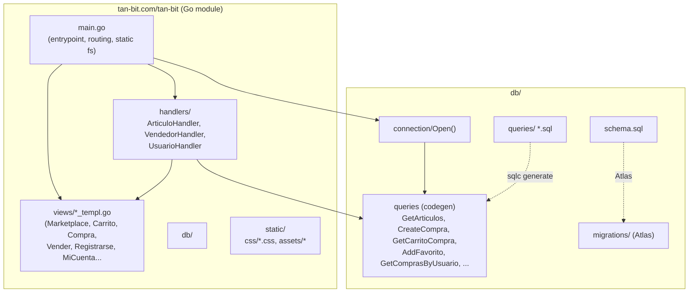
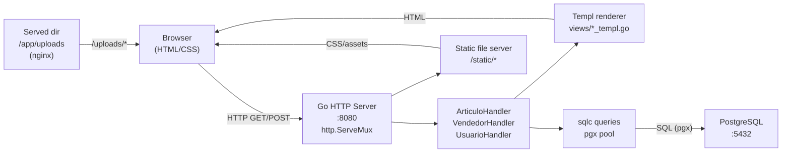
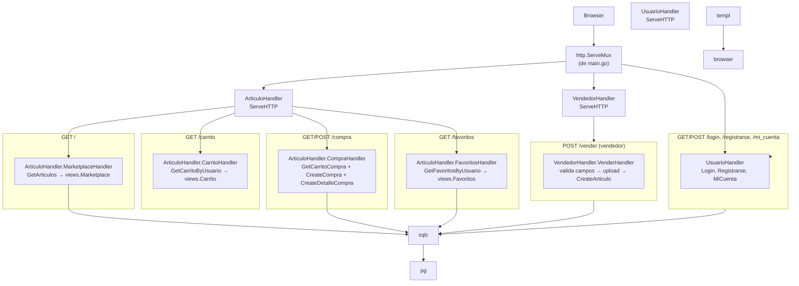
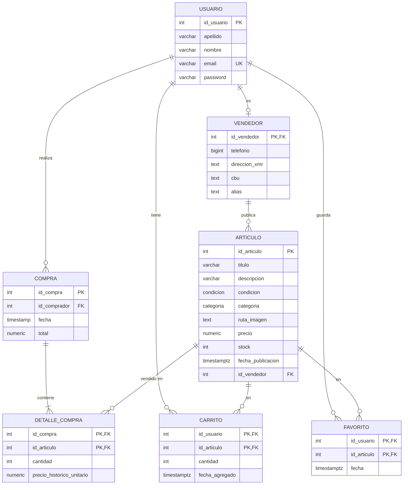

# Decisiones y arquitectura de la aplicación

Architectural style: client/server (3 tiers: presentacion, business logic, db)  
Lenguaje para la API: Go  
Uso de Docker y Docker Compose  
Base de datos relacional: PostgreSQL  
Estrategia para el acceso a datos: **sqlc** (queries tipadas, generadas del SQL) + **Atlas** (migraciones)

Herramientas principales:

| Capa | Herramienta |
|---|---|
| Presentación | [templ](https://templ.guide) (componentes HTML tipados) |
| Lógica de negocio | Handlers nativos de `net/http` (no HTTP REST, no JSON API) |
| Datos | sqlc (queries compiladas) + Atlas (migraciones) |
| Empaquetado | Dockerfile.prod + compose.prod.yaml (api + db + nginx) |

---

## Arquitectura por capas

La aplicación sigue un patrón **client/server** con tres capas bien separadas. No hay JSON, ni `_json.go`, ni `encoding/json` en los handlers. Todas las respuestas son **HTML renderizado con templ**.

```text
┌─────────────────────────────────────────────┐
│  CAPÁS DE PRESENTACIÓN (templates / templ)  │
│  views/*.templ  →  *_templ.go  (renders)    │
│  HTTP handlers (templ)                      │
└─────────────────────────────────────────────┘
┌──────────────────────────────────────────────┐
│  CAPÁS DE NEGOCIO / HANDLERS                 │
│  handlers/ArticuloHandler, UsuarioHandler,   │
│  VendedorHandler                             │
│  - validan entradas, ponen reglas de negocio,│
│    deciden qué query llamar y qué template   │
│    renderizar.                               │
└──────────────────────────────────────────────┘
┌─────────────────────────────────────────────┐
│  CAPÁS DE DATOS                             │
│  PostgreSQL  +  sqlc (queries tipadas)      │
│  ├ db/queries/*.sql  (SQL declarativo)      │
│  ├ db/schema/schema.sql  (DDL)              │
│  ├ db/migrations/  (Atlas)                  │
│  └ db/sqlc/*.go  (codegen)                  │
└─────────────────────────────────────────────┘
```
---

## Capa de presentación (`views/`)

Programación en **templ**: cada plantilla es un `templ Nombre(params)` que escribe HTML al contexto (`Render(ctx, w)`).

### Plantillas principales

| Plantilla | Uso | Parámetros |
|---|---|---|
| `Marketplace` | Lista de artículos (GET `/`) | `arts []db.GetArticulosRow`, `filtros` |
| `Carrito` | Carrito del usuario | `arts []db.GetCarritoByUsuarioRow` |
| `Compra` | Checkout y métodos de pago | `arts []GetCarritoCompraRow`, `entregas []string`, `total string` |
| `Registrarse` | Registro con rol `usuario`/`vendedor` | `msg string`, `role string` |
| `Vender` | Formulario de publicación | `data VenderData`, `categorias`, `condiciones`, `errMsg` |
| `Favoritos` | Lista de favoritos | `arts []db.GetFavoritosByUsuarioRow`, `filtros` |
| `MiCuenta` | Panel personal: datos, piezas, favoritos, compras | `nombre, apellido, email, telefono, alias, cbu, direccionXmr` + `articulos`, `favoritos`, `compras` |
| `Login` | Login | nada |

**Herramientas de presentación en uso:**

- `@Header()` / `@Footer()` — headers y footers comunes.
- `views.BuildFiltros(arts)` / `BuildFiltrosFav(arts)` — construyen filtros para los templates de mercado y favoritos.
- `views.CategoriasDB()` / `views.CondicionesDB()` — listados de categorías y condiciones de vehículo.
- `EntregaLabel(et)` — mapea `tipo_entrega` a texto legible.
- CSS en `static/css/`; icons y assets en `static/assets/`.

---

## Capa de lógica de negocio (`handlers/`)

Los handlers son **structs con un método `ServeHTTP`**, registrados como `http.Handler` en `main.go`. No son simples funciones; tienen estado (la instancia `*db.Queries`) y pueden expandirse con métodos privados de validación/regla de negocio.

### `ArticuloHandler` (`handlers/articulos.go`)

```go
type ArticuloHandler struct { queries *db.Queries }
```

| Método | Rutas | Descripción |
|---|---|---|
| `ServeHTTP` | `GET /` | Switch de rutas; redirige a los handlers de cada funcionalidad. |
| `MarketplaceHandler` | `GET /` | `GetArticulos()`, renderiza `views.Marketplace`. |
| `AddCarritoHandler` | `POST /carrito/add` | Lee `user_id`, `id_articulo`; `AddToCarrito`. Redirige a `/carrito`. |
| `AddFavoritoHandler` | `POST /favoritos/add` | Lee `user_id`, `id_articulo`; `AddFavorito`. Redirige a `/favoritos`. |
| `CarritoHandler` | `GET /carrito` | `GetCarritoByUsuario(user_id)`, renderiza `views.Carrito`. |
| `CompraHandler` | `GET /compra` | `GetCarritoCompra(user_id)`; calcula `entregas`, `total`; renderiza `views.Compra`. `POST /compra` crea `compra` + `detalle_compra` y limpia el carrito. |
| `FavoritosHandler` | `GET /favoritos` | `GetFavoritosByUsuario(user_id)`, renderiza `views.Favoritos`. |

**Flujo de la compra (lógica de negocio):**

```
POST /compra
  1. Leer user_id del cookie.
  2. GET /compra: GetCarritoCompra(user_id) → arts + entregas únicas + total.
  3. POST /compra: CreateCompra(id_comprador, total) → crear la compra.
  4. Para cada artículo: CreateDetalleCompra(id_compra, id_articulo, cantidad, precio_historico).
  5. ClearCarrito(user_id).
  6. Redirect /mi_cuenta.
```

### `VendedorHandler` (`handlers/vendedores.go`)

```go
type VendedorHandler struct { queries *db.Queries }
```

| Método | Ruta | Descripción |
|---|---|---|
| `ServeHTTP` | `/vender` | Rutas de publicación. |
| `VenderHandler` | `GET /vender` | Render `views.Vender` (formulario vacío o con `errMsg`). `POST /vender`: valida campos obligatorios, guarda imágenes en `uploads/`, `CreateArticulo`, redirige a `/`. |

**Points críticos de negocio:**

- Valida campos **obligatorios** antes de insertar: `título`, `descripcion`, `precio`, `ubicación`, `zona_entrega`, `tipo_entrega`.
- La **imagen** se guarda en `uploads/` con nombre `idVendedor_sanitized_titulo_1.ext`.
- La ruta de la imagen se guarda en la DB como `/uploads/<nombre>`.

### `UsuarioHandler` (`handlers/usuarios.go`)

```go
type UsuarioHandler struct { queries *db.Queries }
```

| Método | Ruta | Descripción |
|---|---|---|
| `ServeHTTP` | `/login`, `/registrarse`, `/mi_cuenta` | Autenticación y panel. |
| `RegistrarseHandler` | `GET /registrarse` | Render `views.Registrarse(role="usuario")`. `POST /registrarse`: parsea `role`, valida `terminos`, crea usuario + vendedor (si corresponde). |
| `LoginHandler` | `GET /login` | Render login. `POST /login`: verifica email/password, fija cookie `user_id`. |
| `MiCuentaHandler` | `GET /mi_cuenta` | Lee `user_id`, carga usuario, vendedor, `GetArticulosByVendedor`, `GetFavoritosByUsuario`, `GetComprasByUsuario`, renderiza `views.MiCuenta`. |

---

## Capa de datos (`db/` / `db/sqlc/`)

- **PostgreSQL** (`connection/connection.go`): pool de `pgx`.
- **sqlc** (`sqlc.yaml` → `db/sqlc/`): cada query `.sql` genera código Go tipado.

### Modelos (`db/sqlc/models.go`)

- `Usuario`, `Vendedor`, `Compra`, `DetalleCompra`, `Favorito`, `Carrito`, `Articulo`, etc.
- Hay `sql.NullString` para `direccion_xmr`, `cbu`, etc.

### Queries (`db/queries/*.sql`)

| Query | Descripción |
|---|---|
| `GetArticulos` | Listado de artículos. |
| `GetArticuloByID` | Artículo por ID. |
| `GetArticulosByVendedor` | Artículos del vendedor `id_vendedor`. |
| `CreateArticulo` | Inserta un artículo y devuelve la fila. |
| `UpdateArticulo` / `DeleteArticulo` | Mantenimiento. |
| `GetCarritoByUsuario` | Carrito del usuario. |
| `GetCarritoCompra` | Carrito con datos del vendedor (alias/CBU/XMR) para el checkout. |
| `AddToCarrito`, `RemoveFromCarrito` | Gestión del carrito. |
| `CreateCompra` | Inserta compra (devuelve `id_compra`). |
| `CreateDetalleCompra` | Inserta línea de detalle. |
| `GetComprasByUsuario` | Historial de compras del comprador. |
| `GetFavoritosByUsuario` | Favoritos. |
| `AddFavorito`, `RemoveFavorito` | Favoritos. |
| `CreateUsuario`, `GetUsuarioByEmail`, `GetUsuarioByID`, `GetVendedorByID`, `CreateVendedor`, `UpdateVendedor`, `DeleteVendedor` | Usuarios y vendedores. |
| `GetVendedores`, `GetVendedorByTelefono` | Listado y búsqueda de vendedores. |

### Esquema (`db/schema/schema.sql`)

```
usuario(id_usuario, apellido, nombre, email, password)
vendedor(id_vendedor, telefono, direccion_xmr, cbu, alias)
articulo(id_articulo, titulo, descripcion, condicion, categoria, ruta_imagen,
         precio, stock, fecha_publicacion, ubicacion, tipo_entrega,
         costo_envio, zona_entrega, id_vendedor)
compra(id_compra, id_comprador, fecha, total)
detalle_compra(id_compra, id_articulo, cantidad, precio_historico_unitario)
carrito(id_usuario, id_articulo, cantidad, fecha_agregado)
favorito(id_usuario, id_articulo, fecha)
```

---

## Diagramas

### 1. Estructura de módulos (module view)



### 2. Componentes y conectores (C&C view, runtime)



### 3. Diagrama de flujo de los handlers (flujo de petición)



### 4. Modelo de datos (ERD)



---

## Notas de implementación

- **No hay JSON**. La capa de presentación es HTML generado con templ.
- **Autenticación**: cookie `user_id` (valor entero = `id_usuario`). El handler determina si el usuario es vendedor si el registro de `vendedor` existe.
- **Validación de formularios**: en `VenderHandler` y `RegistrarseHandler`; los errores se muestran como `errMsg` en la vista.
- **Subida de imágenes**: `sanitize()` + `os.MkdirAll("uploads", 0755)` + `io.Copy`. La ruta guardada es `/uploads/<nombre>`.
- **Migrations**: Atlas (`db/migrations/*.sql`). También los ficheros `.sql` en `db/schema/schema.sql` y `db/queries/*.sql` se usan para codegen de sqlc.
- **Docker**: `Dockerfile.prod` (builder + final alpine), `compose.prod.yaml` (api/db/nginx), `run-app.sh` (prod). Imagenes de articulos subidos: `uploads`.
