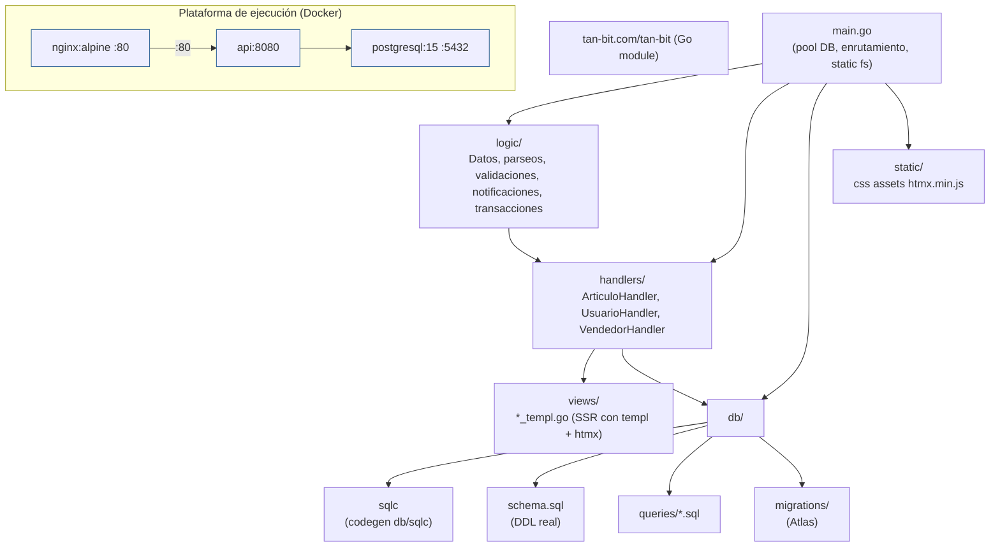
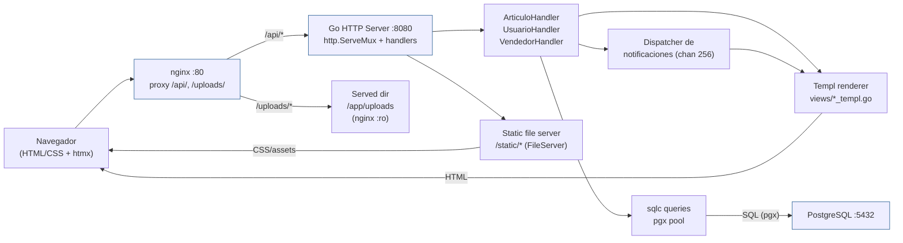
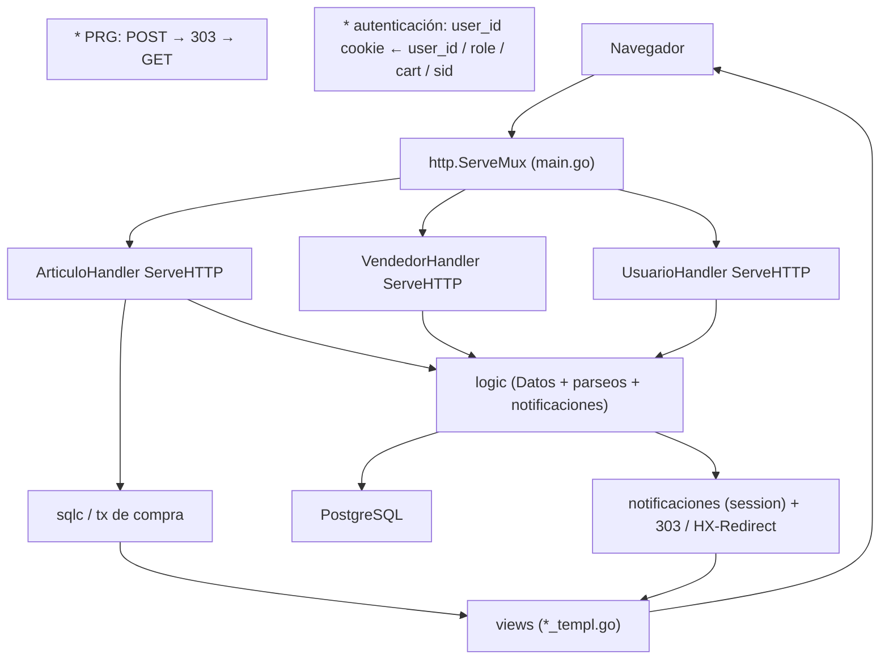
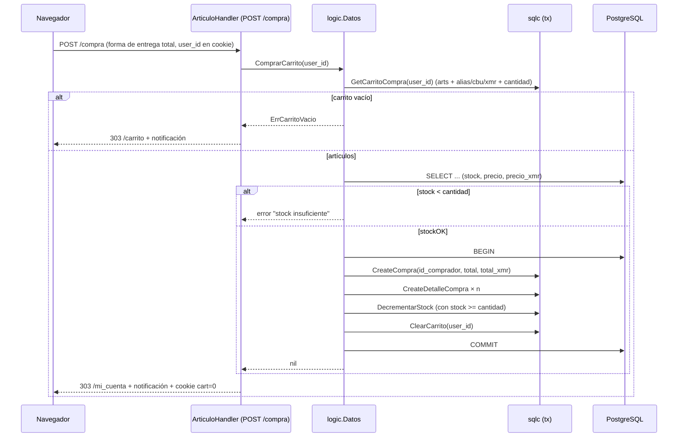

# Decisiones y arquitectura de la aplicación

Estilo arquitectónico: **client/server** (tres niveles: presentación, lógica de negocio, datos).
Lenguaje: **Go 1.26**.
Uso de **Docker** y **Docker Compose** para desarrollo y producción.
Base de datos relacional: **PostgreSQL 15**.
Acceso a datos: **sqlc** (queries tipadas generadas desde SQL) + **Atlas** (migraciones en desarrollo).
Reverse proxy / reutilización de estáticos en producción: **nginx**.

| Capa | Herramienta |
|---|---|
| Presentación | [templ](https://templ.guide) v0.3.1020 (componentes HTML tipados) + htmx |
| Lógica de negocio | Paquete `logic` (parseo, validación, auth, notificaciones, transacciones) |
| Handlers HTTP | Handlers nativos de `net/http` (structs con `ServeHTTP`) |
| Datos | sqlc v1.31.1 + Atlas sobre PostgreSQL |
| Dev | `air` (hot-reload) + `compose.yaml` (api + db) |
| Prod | `Dockerfile.prod` + `compose.prod.yaml` (api + db + nginx) |

> **No hay API JSON.** La capa de presentación es HTML renderizado en el servidor con templ.
> No existen `_json.go` ni respuestas JSON en los handlers; la interactividad progresiva
> está delegada a htmx (parciales, swap OOB, `hx-boost`, búsqueda inline).

---

## 1. Por qué esta estructura

La elección de la arquitectura responde a tres objetivos concretos:

1. **Rendimiento y SEO** — la aplicación genera el HTML completo en el servidor, por lo que
   el motor de búsqueda y los clientes sin JavaScript reciben contenido listo. El HTML es
   pesado, pero es el único costo de tener un sitio típico de marketplace.
2. **Seguridad del formulario** — al no exponer una API JSON, el estado de sesión (cookie
   `user_id`, `role`, `cart`, `sid`) no viaja por líneas independientes; el handler de cada
   ruta tiene control directo sobre la cookie y puede redirigir/401 ante credenciales
   inválidas. Cada ruta responde con `303 See Other` (PRG) luego de un POST, por lo que el
   navegador no vuelve a enviar el mismo formulario al recargar.
3. **Núcleo de negocio testado fuera del servidor** — la lógica de negocio (compra,
   validaciones, parseo, únicas de BD, password) vive en `logic/`, separada de `net/http`.
   Los handlers son espinas de enrutamiento; `go test ./logic` y `go vet` son la parte
   automatable del flujo completo.

La separación que se observa en el código (ver sección 2) es la materialización de esos
objetivos: `handlers` + `logic` + `views` + `db`, sin capas intermedias de mapeo de tipos.

---

## 2. Estructura del código

```
tan-bit.com/tan-bit
├── main.go                  # entrypoint: pool DB, handlers, routers estáticos, LSE
├── go.mod / go.sum          # dependencias: templ, pgx/v5, x/crypto (bcrypt), ...
├── .air.toml                # hot-reload de desarrollo
├── Dockerfile / Dockerfile.prod   # dev (air) y prod (binario estático, alpine)
├── nginx.conf               # proxy inverso + servidores de /uploads (prod)
├── compose.yaml             # compose de desarrollo
├── compose.prod.yaml        # compose de producción (api + db + nginx)
├── example.env              # variables de entorno (DB_*, PORT)
├── Makefile                 # targets: run/test/migrate/apply/status/preCommit/clear
├── run-app.sh               # script de arranque: sqlc+templ, compose, tests hurl
├── db/
│   ├── connection/
│   │   └── connection.go    # abre pool pgx sobre DATABASE_URL / vars de entorno
│   ├── schema/
│   │   └── schema.sql       # DDL de PostgreSQL (estructura real de la BD)
│   ├── queries/             # *.sql declarativos, cada uno con `-- name: ...`
│   ├── sqlc/                # codegen sqlc (sqlc.yaml → db/sqlc/*.go, version 1.31.1)
│   ├── migrations/          # migraciones Atlas (dev)
│   └── sqlc.yaml
├── logic/                   #Negocios:inteligencia: parseo, validación, auth, notificaciones, transacciones
│   ├── datos.go             # Datos{conn,*db.Queries}: ComprarCarrito tx, Actualizar*, CantidadCarrito
│   ├── usuario.go           # Validaciones/CBU/email/parseo de perfil; ActualizarUsuarioInput
│   ├── vender.go            # ParseVender, GuardarImagenTemporal, sanitize, CategoriasDB/CondicionesDB
│   ├── registrarse.go       # ParseRegistrarse, ValidateCBU, ValidatePhoneNumber, HashPassword
│   ├── notificaciones.go    # Notifications dispatcher (canal 256) por sesión
│   ├── cookies.go           # user_id, role, cart, sid; auth fragments para htmx
│   ├── rol.go               # RolCookie / SetRolCookie / ClearRolCookie
│   ├── error.go             # SQLSTATE 23503/23505, EsViolacionUnique/FK, ColumnaViolacionUnique
│   ├── articulo.go          # ErrCarritoVacio, CategoriaValida/CondicionValida/EntregaValida
│   └── error.go
├── handlers/                # net/http handlers
│   ├── http.go              # HealthHandler, NotFoundHandler, páginas estáticas
│   ├── articulos.go         # ServeHTTP por / /carrito /compra /favoritos /articulos /search
│   ├── usuarios.go          # /login /registrarse /mi_cuenta /logout /mi_cuenta/delete
│   └── vendedores.go        # /vender /vender/preview (panel del vendedor)
├── views/                   # templ
│   ├── layout.templ         # Pagina/Base/Header/Footer/Head/CartIcon
│   ├── modelos.templ        # Tipos compartidos: UsuarioData, ArticuloData, FiltroCategoria, ArticuloConfig
│   ├── *.templ              # Marketplace, Carrito, Compra, Vender, Registrarse, Login, Favoritos,...
│   └── *_templ.go           # output de `templ generate`
├── static/
│   ├── css/*.css            # 19 ficheros (shared, layout, marketplace, articulo, compra, carrito...)
│   ├── assets/*.{svg,png}   # logo, íconos, vegetación, imágenes decorativas
│   └── htmx.min.js          # cliente htmx (htmx.config.historyRestoreAsHxRequest = false)
└── tests/
    ├── db_test.go           # TestAPI: TestAPI: GET /health (corre dentro del contenedor api)
    └── requests.hurl        # escenarios de Hurl (registro, login, carrito, compra, vendedor)
```

Reglas de organización vigentes:

- `handlers/` y `logic/` no importan entre sí por vía de negocio; `handlers` usa `logic.Datos`
  y `logic` no conoce `net/http` salvo los tipos de notificación que se pasan a `views`.
- `logic/` contiene únicamente la regla de negocio; el parseo de multipart y las decisiones
  de redirección (`303`, `HX-Redirect`) permanecen en los handlers.
- `db/queries/*.sql` son puramente SQL; `db/sqlc` es artefacto `sqlc generate` y **no se
  edita manualmente**.
- `static/` es servido tal cual: los CSS se enlazan de forma explícita en `views.Head()`.

---

## 3. Flujo general de una petición

### 3.1. Enrutamiento (`main.go`)

```
main()
├─ logic.StartNotificationDispatcher()   # rutina única que consume el canal de notificaciones
├─ connection.Open()                     # pool pgx
├─ NewArticuloHandler / NewUsuarioHandler / NewVendedorHandler
├─ http.HandleFunc: /health, /evento, /privacidad, /terminos, /historia, /creadores, /contacto
├─ /static/          → http.FileServer(http.Dir("static"))
├─ /uploads/         → http.FileServer(http.Dir("uploads"))   (dev)
├─ /vender, /vender/preview            → VendedorHandler
├─ /registrarse, /login, /logout, /mi_cuenta, /mi_cuenta/delete → UsuarioHandler
├─ /search, /                            → ArticuloHandler
└─ http.ListenAndServe(":8080", nil)
```

### 3.2. Ruta → handler → vista

| Método | Ruta | Handler | Vista |
|---|---|---|---|
| GET | `/` | `ArticuloHandler.MarketplaceHandler` | `views.Marketplace` (con `GrillaMarketplace` si es htmx+filtro) |
| GET | `/carrito` | `CarritoHandler` | `views.Carrito(arts,total,totalXmr)` |
| POST | `/carrito/add` | `AddCarritoHandler` | notificación + `303`/`HX-Redirect` a `/carrito` |
| DELETE | `/carrito/{id}` | `RemoveCarritoHandler` | notificaciones OOB + `CartIcon` (swap OOB) |
| GET | `/compra` | `CompraHandler` (GET) | `views.Compra(arts, entregas, total, totalXmr)` |
| POST | `/compra` | `CompraHandler` (POST) → `Datos.ComprarCarrito` tx | `303 /mi_cuenta` + notificación |
| GET | `/favoritos` | `FavoritosHandler` | `views.Favoritos` o `GrillaFavoritos` (htmx+filtro) |
| POST | `/favoritos/add` | `AddFavoritoHandler` | notificación + `303` |
| DELETE | `/favoritos/{id}` | `RemoveFavoritoHandler` | notificaciones OOB |
| GET POST | `/articulos/{id}` | `FichaArticuloHandler` (modal) | `VistaFicha` |
| GET | `/articulos/{id}/editar` | `EditarArticuloHandler` | `VistaEditarArticulo` |
| POST | `/articulos/{id}` | `ActualizarArticuloHandler` | `303 /mi_cuenta` |
| DELETE | `/articulos/{id}` | `DeleteArticuloHandler` | notificación + `303 /` |
| GET | `/search` | `SearchHandler` | `views.Busqueda` (fragmento para el header) |
| GET|POST | `/login` | `UsuarioHandler` | `views.Login` |
| GET|POST | `/registrarse` | `UsuarioHandler` | `views.Registrarse` |
| GET|POST | `/mi_cuenta` | `MiCuentaHandler` | `views.MiCuenta` |
| POST | `/logout` | `LogoutHandler` | limpia cookies → `/login` |
| POST | `/mi_cuenta/delete` | `DeleteAccountHandler` | notificación + `303 /login` |
| GET|POST | `/vender` | `VendedorHandler` | `views.Vender` |
| POST | `/vender/preview` | `PreviewImagenHandler` | `VistaPrevia(url)` (htmx) |

### 3.3. Padrón PRG y htmx

1. El cliente POSTea a `/compra`, `/vender`, `/registrarse`, `/login`, `/mi_cuenta`, etc.
2. El handler valida, escribe las notificaciones en un `map[string][]logic.Notification`
   (clave = `session` derivada del `user_id` o, anónimo, de la cookie `sid`),
   y responde **303 See Other** a la ruta de "ver" (generalmente `/mi_cuenta` o `/`).
3. El navegador vuelve a GET la ruta destino; `views.Pagina` decide el alcance:
   - `HX-Request == true` → solo el fragmento HTML (`@contenido`) + `@Notificaciones(...)`
     con `hx-swap-oob="true"`; no se repinta el layout.
   - En otro caso → `views.Base` completo (Header/Footer/HTML), incluyendo `role` y
     `cart` (íconos de cuenta e ítems) extraídos de las cookies.

Las operaciones de borrado (`/carrito/{id}`, `/favoritos/{id}`, `/articulos/{id}`) responden
en sí mismas con `HX-Redirect` (cuando vienen de htmx) o con HTML + notificaciones, y a veces
con un swap OOB de `CartIcon` para que el widget del header se actualice sin recargar.

---

## 4. Capa de presentación (`views/`)

Programación **templ**: `templ Nombre(params)` escribe HTML al contexto; `Render(ctx, w)`
genera la respuesta. El archivo `views/layout.templ` declara los componentes compartidos:

- `Header(rol, lleno)` — logo, buscador htmx (`/search`), botones VENDER, FAVORITOS,
  CARRITO (`CartIcon(lleno, oob)`), dropdown de cuenta con ícono según `rol`.
- `Footer()` — valores promocionales (DESCENTRALIZADO / CONFIANZA / OPORTUNIDAD),
  enlaces de ayuda y legales.
- `Head()` — hojas de estilo `static/css/*.css` + `htmx.min.js`.
- `Base(contenido, session, rol, lleno)` — `<html><body>` con `hx-boost="true"`, `hx-target="#main"`,
  y el DOM completo.
- `Pagina(w, r, contenido)` — ramifica entre fragmento (htmx) y página completa.
- `Notificaciones(items)` / `Notificacion(n)` — contenedor/widget de avisos con swap OOB.

Tipos compartidos (definidos en `views/modelos.templ`): `UsuarioData`, `ArticuloData`,
`FiltroCategoria`, `ArticuloConfig`. La plantilla `Vender` recibe `VenderInput`,
`[db.Categoria]`, `[db.Condicion]`; `Compra`/`ResumenCarrito` reciben `[]ArticuloData`,
`[]string` de entregas, `total`, `totalXmr`.

---

## 5. Capa de lógica de negocio (`logic/`)

El paquete `logic` concentra la inteligencia de negocio; es independiente de `net/http`
(excepto las definiciones de notificación que se comunican con la vista).

| Archivo | Responsabilidad |
|---|---|
| `datos.go` | `Datos{conn *sql.DB, q *db.Queries}`: `NuevoDatos`, `Queries()`, `ComprarCarrito` (tx con creación de compra, detalle, decremento de stock, limpieza del carrito), `ActualizarDatosUsuario`, `ActualizarVendedor`, `ActualizarArticulo`, `CantidadCarrito`. |
| `usuario.go` | `ValidarEmail`, `CategoriaValida/CondicionValida/EntregaValida` (reciclados), `ActualizarUsuarioInput/ParseActualizarUsuario`, `ActualizarVendedorInput/ParseActualizarVendedor`. |
| `vender.go` | `VenderInput`, `ParseVender(r, id_vendedor)` (campos obligatorios: título, descripción, ubicación, precio, stock, tipo+zona de entrega; `costo_envio`/`precio_xmr` opcionales), `sanitize()` para el nombre de archivo, `GuardarImagenTemporal()` (límite 10 MB, extensiones jpg/png/webp, `tmp-<unixnano>.ext`, limpieza de anteriores), `CategoriasDB()`, `CondicionesDB()`. |
| `registrarse.go` | `RegistrarseInput`, `ParseRegistrarse` (email regex, password ≥6 y coincidencia, nombre/apellido no vacíos, `role` normalizado, teléfono/CBU/alias cuando `role == vendedor`, checkbox `terminos`), `digitsOnly`, `ValidatePhoneNumber`, `ValidateCBU` (13 dígitos exactos), `HashPassword`/`CheckPassword` (bcrypt), `IsValidString`. |
| `notificaciones.go` | `NotificationType` (success/error/info/warning), `Notification`, dispatcher con canal buffer 256 (`startOnce`), `AddNotification(session, n)` no bloqueante, `TakeNotifications(session)` (consume), `SessionID(w, r)` (`user:<id>` o `sid:<hex>` con cookie `sid`). |
| `cookies.go` | `IsHtmxRequest`, `GetCookieOrRedirect(w, r)` (redirect o fragmento de acceso requerido para htmx), `writeAuthRequiredFragment`, `CheckAuth`, `CarritoCookie`/`SetCarritoCookie` (cookie `cart`, valor entero, `MaxAge=-1` cuando es 0). |
| `rol.go` | `RolCookie`, `SetRolCookie`, `ClearRolCookie` (cookie `role`: `vendedor`/`usuario`). |
| `error.go` | Constantes SQLSTATE `23503` (FK) y `23505` (UNIQUE); `EsErrorPg`, `EsViolacionFK`, `EsViolacionUnique`, `ColumnaViolacionUnique` (mapea constraint a `email`/`cbu`/`alias`/`telefono`/`telefono`). |
| `articulo.go` | `ErrCarritoVacio`; validadores de enumerado. |

La clave de la escritura es **`ComprarCarrito`** (consulta `GetCarritoCompra` y valida stock, luego
abre una transacción explícita): `CreateCompra` → `CreateDetalleCompra` por artículo →
`DecrementarStock` (con filtro `stock >= $2`) → `ClearCarrito`, y `tx.Commit()`. Esto garantiza
que un stock negativo no deja una compra a medias.

---

## 6. Capa HTTP (`handlers/`)

### 6.1. `ArticuloHandler`

```go
type ArticuloHandler struct { datos *logic.Datos }
```

| Método | Ruta | Acción |
|---|---|---|
| `ServeHTTP` | vía `main.go` | switch de rutas (casi todas) |
| `MarketplaceHandler` | `GET /` | `GetArticulos()`; filtro `categoria` aplicado en memoria; si htmx y query `categoria` → `GrillaMarketplace`, si no `Marketplace` + `BuildFiltros(todos)` |
| `CarritoHandler` | `GET /carrito` | `GetCarritoByUsuario` + totales `price*cantidad` y `price_xmr*cantidad` |
| `AddCarritoHandler` | `POST /carrito/add` | `AddToCarrito(1)` (upsert); actualiza cookie `cart`; `HX-Redirect` si htmx, `303` en otro caso |
| `RemoveCarritoHandler` | `DELETE /carrito/{id}` | `RemoveFromCarrito`, actualiza cookie, responde notificaciones OOB + `CartIcon` |
| `FavoritosHandler` | `GET /favoritos` | `GetFavoritosByUsuario` + filtro |
| `AddFavoritoHandler` | `POST /favoritos/add` | `AddFavorito` (`ON CONFLICT DO NOTHING`); `303` |
| `RemoveFavoritoHandler` | `DELETE /favoritos/{id}` | `RemoveFavorito`; notificaciones OOB |
| `FichaArticuloHandler` | `GET /articulos/{id}` | `GetArticuloCompletoByID` → `VistaFicha` (modal htmx) |
| `EditarArticuloHandler` | `GET /articulos/{id}/editar` | `GetArticuloCompletoByVendedor` → `VistaEditarArticulo` |
| `ActualizarArticuloHandler` | `POST /articulos/{id}` | `ParseActualizarArticulo` + `ActualizarArticulo` (`UpdateArticuloDeVendedor`); si `filas==0` → advertencia |
| `DeleteArticuloHandler` | `DELETE /articulos/{id}` | `DeleteArticuloDeVendedor`; si `filas==0` → 404 |

### 6.2. `UsuarioHandler`

| Método | Ruta | Acción |
|---|---|---|
| `ServeHTTP` | vía `main.go` | `/login`, `/registrarse`, `/mi_cuenta`, `/logout`, `/mi_cuenta/delete` |
| `RegistrarseHandler` | GET/POST | `ParseRegistrarse` → `CreateUsuario` (bcrypt); si `vendedor` y datos completos → `CreateVendedor`; mapa de violaciones UNIQUE (`email`, `cbu`, `alias`, `telefono`) → `303 /registrarse` o `/mi_cuenta`; cookie `user_id` + `role` |
| `LoginHandler` | GET/POST | `GetUsuarioByEmail` + `CheckPassword`; si `GetVendedorByID` ok → `role=vendedor`; cookie + notificación |
| `MiCuentaHandler` | GET/POST | POST → `actualizarMiCuenta` (verifica si vienen `password_actual`/`password_nueva` → `actualizarContrasenia`, si no → `actualizarDatos`); GET → `UsuarioData` + `GetArticulosByVendedor` + `GetFavoritosByUsuario` + `GetComprasByUsuario` → `MiCuenta` |
| `actualizarDatos` | POST `/mi_cuenta` | `ParseActualizarUsuario`/vendedor; `ActualizarDatosUsuario` + `ActualizarVendedor` (conserva hash si no se envió contraseña); mapa de UNIQUE; `SetRolCookie(vendedor)` si corresponde |
| `actualizarContrasenia` | POST `/mi_cuenta` | verifica `password_actual` (bcrypt) y long.≥6; `ActualizarDatosUsuario` con nuevo hash |
| `LogoutHandler` | POST/GET `/logout` | `ClearRolCookie` + `clearSessionCookie` + notificación → `/login` |
| `DeleteAccountHandler` | POST `/mi_cuenta/delete` | `DeleteUsuario` (las FK de `vendedor`/`carrito`/`favorito`/`compra`>`usuario` son CASCADE); limpia cookie → `/login` |

### 6.3. `VendedorHandler`

| Método | Ruta | Acción |
|---|---|---|
| `ServeHTTP` | vía `main.go` | `/vender`, `/vender/preview` |
| `VenderHandler` | GET/POST `/vender` | requiere `GetVendedorByID` ok **y** `Telefono != 0` (si no, redirige a `/registrarse` con aviso); `ParseVender` → `CreateArticulo` (con `NullString`/`NullFloat64` para campos opcionales); guarda la imagen en `uploads/<idVendedor>_<sanitized>_1.<ext>`; notificación + `303 /mi_cuenta` |
| `PreviewImagenHandler` | POST `/vender/preview` | `GuardarImagenTemporal` → `VistaPrevia(url)` (htmx) |

### 6.4. Maniobras comunes de autenticación y errores

- **`GetCookieOrRedirect`** es el punto único de entrada para validar sesión; devuelve
  `(id, ok)`. Si no hay cookie `user_id`, responde redirección a `/login` (o un fragmento
  `ACCESO REQUERIDO` en htmx).
- **Violaciones UNIQUE** se detectan vía `pgconn.PgError.Code == 23505` y se mapean a mensajes
  por constraint (`usuario_email`, `vendedor_cbu`, `vendedor_alias`, `vendedor_telefono`).
- **Upload de imágenes**: el HTML presenta el formulario con `multipart/form-data` y el
  handler parsea `r.ParseMultipartForm(32<<20)` (32 MB) antes del POST, y `PreviewImagenHandler`
  usa `ParseMultipartForm(10<<20)`. Se respeta `client_max_body_size 10M` en nginx.

---

## 7. Capa de datos (`db/`)

### 7.1. Conexión

`db/connection/connection.go` abre un `database/sql` con el driver `pgx/v5 stdlib` sobre una
URL construida con `DB_HOST`, `DB_PORT`, `DB_USER`, `DB_PASSWORD`, `DB_NAME` (lectura de
`example.env` por `run-app.sh` / `Makefile`). El pool lo gestiona `database/sql`.

### 7.2. Esquema (`db/schema/schema.sql`)

```sql
CREATE TYPE condicion AS ENUM ('nuevo', 'muy bueno', 'usado', 'reacondicionado', 'a reparar');
CREATE TYPE categoria AS ENUM ('notebook','pantalla','electronica','periferico','accesorio','audio','video','gaming','comunicacion','analogico','decoracion');
CREATE TYPE entrega   AS ENUM ('envio a domicilio','retiro en persona','ambos');

CREATE TABLE usuario (
    id_usuario  SERIAL      CONSTRAINT pk_usuario PRIMARY KEY,
    apellido    VARCHAR(50) NOT NULL,
    nombre      VARCHAR(50) NOT NULL,
    email       VARCHAR(50) UNIQUE NOT NULL,
    password    VARCHAR(255) NOT NULL
);

CREATE TABLE vendedor (
    id_vendedor     INTEGER  CONSTRAINT pk_vendedor PRIMARY KEY
                           CONSTRAINT fk_vendedor_usuario REFERENCES usuario(id_usuario)
                               ON DELETE CASCADE ON UPDATE CASCADE,
    telefono        BIGINT   UNIQUE NOT NULL,
    direccion_xmr   TEXT     UNIQUE     NULL,
    cbu             TEXT     UNIQUE NOT NULL,
    alias           TEXT     UNIQUE NOT NULL
);

CREATE TABLE articulo (
    id_articulo       SERIAL       CONSTRAINT pk_producto PRIMARY KEY,
    titulo            VARCHAR(50)  NOT NULL,
    descripcion       VARCHAR(250) NOT NULL,
    condicion         condicion    NOT NULL,
    categoria         categoria    NOT NULL,
    ruta_imagen       text         NULL,
    precio            DOUBLE PRECISION NOT NULL CHECK (precio >= 0),
    precio_xmr        DOUBLE PRECISION NOT NULL CHECK (precio_xmr >= 0),
    stock             INTEGER        NOT NULL CHECK (stock >= 0),
    fecha_publicacion TIMESTAMP WITH TIME ZONE DEFAULT CURRENT_TIMESTAMP,
    ubicacion         text         NOT NULL,
    tipo_entrega      entrega      NOT NULL,
    costo_envio       DOUBLE PRECISION    NULL CHECK (costo_envio >= 0),
    zona_entrega      text             NULL,
    id_vendedor       INTEGER      NOT NULL CONSTRAINT fk_producto_vendedor REFERENCES vendedor(id_vendedor)
                               ON DELETE CASCADE ON UPDATE CASCADE
);

CREATE TABLE compra (
    id_compra       SERIAL          CONSTRAINT pk_compra PRIMARY KEY,
    id_comprador    INTEGER         NOT NULL CONSTRAINT fk_compra_usuario REFERENCES usuario(id_usuario)
                               ON DELETE CASCADE ON UPDATE CASCADE,
    fecha           TIMESTAMP       NOT NULL,
    total           DOUBLE PRECISION  NOT NULL CHECK (total >= 1),
    total_xmr       DOUBLE PRECISION  NOT NULL CHECK (total_xmr >= 0)
);

CREATE TABLE detalle_compra (
    id_compra                   INTEGER     NOT NULL CONSTRAINT fk_detalle_compra REFERENCES compra(id_compra)
                               ON DELETE CASCADE ON UPDATE CASCADE,
    id_articulo                 INTEGER     NOT NULL CONSTRAINT fk_detalle_producto REFERENCES articulo(id_articulo)
                               ON DELETE CASCADE ON UPDATE CASCADE,
    cantidad                    INTEGER     NOT NULL CHECK (cantidad >= 1),
    precio_historico_unitario   DOUBLE PRECISION NOT NULL CHECK (precio_historico_unitario >= 1),
    precio_historico_unitario_xmr DOUBLE PRECISION NOT NULL CHECK (precio_historico_unitario_xmr >= 0),
    CONSTRAINT pk_detalle_compra PRIMARY KEY (id_compra, id_articulo)
);

CREATE TABLE carrito (
    id_usuario     int NOT NULL CONSTRAINT fk_usuario REFERENCES usuario(id_usuario)
                    ON DELETE CASCADE ON UPDATE CASCADE,
    id_articulo    int NOT NULL CONSTRAINT fk_articulo REFERENCES articulo(id_articulo)
                    ON DELETE CASCADE ON UPDATE CASCADE,
    cantidad       int NOT NULL CHECK (cantidad >= 1),
    fecha_agregado TIMESTAMP WITH TIME ZONE DEFAULT CURRENT_TIMESTAMP,
    PRIMARY KEY (id_usuario, id_articulo)
);

CREATE TABLE favorito (
    id_usuario     int NOT NULL CONSTRAINT fk_usuario REFERENCES usuario(id_usuario)
                    ON DELETE CASCADE ON UPDATE CASCADE,
    id_articulo    int NOT NULL CONSTRAINT fk_articulo REFERENCES articulo(id_articulo)
                    ON DELETE CASCADE ON UPDATE CASCADE,
    fecha          TIMESTAMP WITH TIME ZONE DEFAULT CURRENT_TIMESTAMP,
    PRIMARY KEY (id_usuario, id_articulo)
);
```

**Puntos clave del esquema:**

- `usuario` es la raíz de autenticación; `vendedor` es **1:1** con `usuario` vía FK
  `id_vendedor → usuario(id_usuario)` (CASCADE en ambos sentidos).
- `articulo` añade los campos `precio_xmr`, `fecha_publicacion` (timestamptz, `now()`),
  `ubicacion`, `tipo_entrega` (enum), `costo_envio`, `zona_entrega` (ambos `text`, opcionales).
- `precio`, `precio_xmr`, `costo_envio`, `total`, `total_xmr`, y los precios históricos
  están en `DOUBLE PRECISION`; `total` y `precio_historico_unitario` tienen `CHECK >= 1`.
- `compra` → `detalle_compra` es **`id_compra × id_articulo`** PK (línea de detalle).
- `carrito` y `favorito` usan PK compuesta `(id_usuario, id_articulo)`; `ON DELETE CASCADE`
  elimina las filas hijas al borrar el usuario.
- Las FK de `carrito`/`favorito` apuntan a `articulo`/`usuario` con CASCADE.

### 7.3. sqlc y migraciones

- `sqlc.yaml`: `queries: ./db/queries`, `schema: ./db/schema/schema.sql`, generación en
  `db/sqlc` con `emit_json_tags: true`. La herramienta genera los métodos tipados
  (`GetArticulos`, `CreateCompra`, `GetCarritoCompra`, `AddFavorito`, `DecrementarStock`, …)
  y los modelos `db.Articulo`, `db.Categoria`, `db.Entrega`, `db.Condicion`, …
- `db/migrations/` (Atlas): servicios de migración en desarrollo; `make migrate name=X`
  genera diffs, `make apply/status` los aplica/revisa. (En producción el esquema se
  inicializa una sola vez con `db/schema/schema.sql` montado como `01-schema.sql`
  en `docker-entrypoint-initdb.d`.)
- **Los `*.sql` en `db/queries` no son migraciones**: son consultas declarativas
  para el codegen; las migraciones se concentran en `db/migrations`. Ese fue un
  punto de confusión en versiones anteriores.

---

## 8. Despliegue: Docker, Docker Compose y nginx

### 8.1. Imágenes y servicios

**Desarrollo** (`compose.yaml` + `.air.toml`): `api` (hereda `Dockerfile`, que instala
`air`, corre `air` en un volumen bind de todo el proyecto con caché de módulos y
build; `db` = `postgres:15-alpine` con volumen `pgdata`, puerto host `5432`).
**Producción** (`Dockerfile.prod` + `compose.prod.yaml`):

```
                          puerto 80 (host)        puerto 8080 (host)
   navegador ──:80──────▶ nginx:alpine ──/api/──▶ api (golang:1.26, binario /usr/local/bin/tan-bit)
                              │                        │
                              │  /uploads/ (alias /app/uploads, ro)       │
                              │  expires 30d, Cache-Control public/immutable, limit_except GET HEAD │
                              └───────────────────────────────┘
```

La imagen de producción (**multi-stage**, `alpine:3.20` final):
`builder` (golang:1.26-alpine) descarga deps, copia el repo y compila `CGO_ENABLED=0 -o /app/tan-bit`;
`final` añade un usuario `app` (uid 1000), crea `/app/uploads` y `/app/static`, instala `curl`
(para el healthcheck), copia el binario y `static/`, y arranca `tan-bit` sin root.

`compose.prod.yaml` levanta tres servicios:
- **api**: `Dockerfile.prod`, volume `uploads` (persiste las imágenes), healthcheck `/health`
  (3 retries, start_period 3s), `depends_on database` condicional `service_healthy`,
  `restart: unless-stopped`.
- **database**: `postgres:15-alpine`, `pgdata` volumen persistente, `schema.sql` montado
  como `/docker-entrypoint-initdb.d/01-schema.sql:ro` (solo la primera vez), puerto
  `127.0.0.1:5433:5432` (no expuesto a la red del host).
- **nginx**: `nginx:alpine`, config montada como `/etc/nginx/conf.d/default.conf:ro`,
  volumen `uploads` montado **read-only** (`:ro`), puerto `80:80`, `depends_on: api`.

### 8.2. Configuración de nginx (`nginx.conf`)

Nginx es un reverse proxy, no un servidor de aplicaciones: solo dos `location`s están
definidos en este proyecto:

```nginx
server {
    listen 80;
    server_name _;

    # Proxy inverso hacia la API Go (puerto 8080 dentro de la red compose)
    location /api/ {
        proxy_pass http://localhost:8080/;
        proxy_set_header Host $host;
        proxy_set_header X-Real-IP $remote_addr;
        client_max_body_size 10M;   # máx de carga útil para uploads
    }

    # Servidor de imágenes estáticas, montaje read-only desde compose
    location /uploads/ {
        alias /app/uploads/;
        expires 30d;
        add_header Cache-Control "public, immutable";
        limit_except GET HEAD { deny all; }   # solo lectura
    }
}
```

**Por qué nginx y por qué así:**

1. **Separación de responsabilidades**: nginx es el único punto que conoce los puertos
   `80` (host) y la ruta `/uploads/`; la API Go permanece en `8080` y expone únicamente
   su `ServeMux` (health, imágenes, lógica), reduciendo su superficie de exposición.
2. **Públicación selecciva de rutas**: `/api/`, `/uploads/`, `/static/` y las rutas de
   la app se pueden mapear sin que el router de Go sea el que decida los puertos.
   En esta versión concreta, nginx solo declara `/api/` y `/uploads/`; el resto de la
   UI se sirve directamente por la API en `localhost:8080` (volúmenes bind en desarrollo,
   y la salida `make run`/`run-app.sh` expone `:8080`).
3. **Caché y tamaño de carga útil**: `expires 30d` + `Cache-Control: public, immutable`
   para las imágenes (se garantiza estabilidad del nombre de archivo, revisado en
   producción: `<idVendedor>_<sanitized_titulo>_1.ext`), y `client_max_body_size 10M`
   para no expulsar peticiones de subida del proxy.
4. **Restricción de método** (`limit_except GET HEAD { deny all }`) evita que `/uploads/`
   responda a POST/PUT, cerrando el directorio subido.
5. **Volumen compartido entre servicios**: `nginx` y `api` leen/escriben el mismo
   `uploads:`; en producción el mount de nginx es `:ro`, y `api` (desde docker build)
   empieza con el directorio vacío `mkdir -p /app/uploads`. En desarrollo (`run-app.sh`)
   el volumen bind se reinicia con `down -v` antes de cada `up`, por lo que `uploads/`
   remonta los ficheros que dejó la API en el host.

### 8.3. Flujo de red en producción

```text
navegador → 80 (nginx) → /api/* → 8080 → API Go
                    → /uploads/* → alias /app/uploads/ (volumen)
                    → cualquier otra ruta → la API responde (ruteara por 8080)
```

### 8.4. Comandos de trabajo

| Comando | Efecto |
|---|---|
| `make run` | `sqlc generate && templ generate`, `docker compose --env-file example.env -f compose.prod.yaml up -d --build --wait` (espera que api y db estén healthy) |
| `make test` | `go test -count=1 -v ./tests` (con `DB_HOST=localhost DB_PORT=5433`) + `hurl --test` (registro, login, carrito, compra, publicación de vendedor, etc.) |
| `make stop` / `make clear` | `down` (volúmenes confiables) / `down --volumes --rmi local` + `rm -rf uploads` |
| `make migrate name=X` / `apply` / `status` | Atlas (dev): `diff`/`apply`/`status` sobre `db/migrations` |
| `./run-app.sh` | Continúa en un bucle: genera, baja volúmenes, `up -d --build --wait`, corre hurl, y mantiene el contenedor api/db; `n` salir |
| `go build ./...`, `go vet ./...` | Verificación de compilación/vetos en local |

---

## 9. Diagramas

### 9.1. Módulos (module view)



### 9.2. Componentes y conectores (C&C view, runtime)



### 9.3. Flujo de una petición (handlers)



### 9.4. Flujo de compra (transacción, `Datos.ComprarCarrito`)



### 9.5. Modelo de datos (ERD), compatible con `db/schema/schema.sql`

```mermaid
erDiagram
    USUARIO {
        int id_usuario PK
        varchar apellido
        varchar nombre
        varchar email UK
        varchar password
    }
    VENDEDOR {
        int id_vendedor PK, FK
        bigint telefono UK
        text direccion_xmr UK
        text cbu UK
        text alias UK
    }
    ARTICULO {
        int id_articulo PK
        varchar titulo
        varchar descripcion
        condicion condicion
        categoria categoria
        text ruta_imagen
        double precio // CHECK (precio >= 0)
        double precio_xmr // CHECK (precio_xmr >= 0)
        int stock // CHECK (stock >= 0)
        timestamptz fecha_publicacion // DEFAULT now()
        text ubicacion
        entrega tipo_entrega
        double costo_envio // CHECK (costo_envio >= 0)
        text zona_entrega
        int id_vendedor FK
    }
    COMPRA {
        int id_compra PK
        int id_comprador FK
        timestamp fecha
        double total // CHECK (total >= 1)
        double total_xmr // CHECK (total_xmr >= 0)
    }
    DETALLE_COMPRA {
        int id_compra PK, FK
        int id_articulo PK, FK
        int cantidad // CHECK (cantidad >= 1)
        double precio_historico_unitario // CHECK (precio_historico_unitario >= 1)
        double precio_historico_unitario_xmr // CHECK (precio_historico_unitario_xmr >= 0)
    }
    CARRITO {
        int id_usuario PK, FK
        int id_articulo PK, FK
        int cantidad // CHECK (cantidad >= 1)
        timestamptz fecha_agregado // DEFAULT now()
    }
    FAVORITO {
        int id_usuario PK, FK
        int id_articulo PK, FK
        timestamptz fecha // DEFAULT now()
    }

    USUARIO ||--o| VENDEDOR : "es (1:1)"
    VENDEDOR ||--o{ ARTICULO : "publica"
    USUARIO ||--o{ COMPRA : "realiza"
    COMPRA ||--|{ DETALLE_COMPRA : "contiene"
    ARTICULO ||--o{ DETALLE_COMPRA : "aparece en"
    USUARIO ||--o{ CARRITO : "agrega"
    ARTICULO ||--o{ CARRITO : "incluye"
    USUARIO ||--o{ FAVORITO : "guarda"
    ARTICULO ||--o{ FAVORITO : "favorita"
```

> Enumeraciones (tipo `condicion`, `categoria`, `entrega`) están incorporadas en
> `schema.sql` como `CREATE TYPE ... AS ENUM`; no son entidades de la base, por eso
> no figuran como entidades en el ERD. El codebase usa los tipos Go `db.Condicion`,
> `db.Categoria`, `db.Entrega` generados por sqlc.

### 9.6. Despliegue en producción

```mermaid
flowchart LR
    user["Usuario / cliente"]
    nginx["nginx:alpine<br/>:80"]
    api["api<br/>golang:1.26 :8080"]
    db["database<br/>postgres:15-alpine :5432"]

    user -->|":80"| nginx
    nginx -->|"GET/POST /api/*"| api
    nginx -->|"GET /uploads/*"| api
    nginx -.->|volumen uploads (ro)| api
    api -->|"pgx pool"| db
    db -->|"esquema: schema.sql </br>(docker-entrypoint-initdb.d/01-schema.sql)"| db

    subgraph internet["Internet"]
        user
    end
    subgraph compose_prod["compose.prod.yaml (host)]
        nginx
        api
        db
    end
    style nginx fill:#eef,stroke:#369
    style api fill:#eef,stroke:#369
    style db fill:#eef,stroke:#369
```

---

## 10. Pruebas

- `tests/db_test.go` (unitaria): `TestAPI` → `GET /health` == 200 (corre dentro del
  contenedor api, con `DB_HOST=localhost DB_PORT=5433`).
- `tests/requests.hurl`: escenarios de Hurl (registro, login, carrito, compra,
  publicación de vendedor, favoritos, y GET/POST de cada flujo clave). Corre con
  `hurl --test --file-root . --variable host=http://localhost:8080 tests/requests.hurl`.
- Los tests se ejecutan **en el anfitrión** con el pool de PostgreSQL en `localhost:5433`
  (volumen `pgdata` recreado por `run-app.sh`); no confundir con la BD del contenedor
  (que se conecta por `database:5432` desde el propio cluster).

---

## 11. Notas de implementación y decisiones de diseño

1. **Datos filtrados antes de tocar la base**: en `VenderHandler` y `RegistrarseHandler`
   se validan campos **antes** de insertar; las únicas violaciones Originales que el
   código maneja (UNIQUE de email/cbu/alias/telefono) se capturan de `pgconn.PgError`
   y se traducen a mensajes de usuario.
2. **Imágenes**: solo se guarda el archivo temporal `tmp-<unixnano>.<ext>` hasta que el
   vendedor publica (límite 10 MB, extensiones `jpg/jpeg/png/webp`, `Content-Type`
   verificado); al publicar, `uploads/<idVendedor>_<sanitized_titulo>_1.<ext>` y el
   path guardado es `/uploads/<nombre>`. El nombre garantiza estabilidad para el
   `Cache-Control: public, immutable` de nginx.
3. **Auth**: cookie `user_id` (valor entero, `HttpOnly`, `SameSite=Lax`) es la sesión;
   la cookie `role` es legible (no `HttpOnly`) y decide el ícono de la cuenta; la
   cookie `cart` (entero) refresca el widget del header sin consultar BD.
4. **`views.Pagina`** decide, según `HX-Request`, el nivel de renderizado. Esto es
   lo que permite que htmx recargue el header/carrito con `hx-swap-oob`, y que las
   páginas completas (con `Base`) conserven `role`/`cart` en el mismo flujo.
5. **SQL no es migración**: el archivo `db/schema/schema.sql` define el estado deseado
   del esquema; `db/queries/*.sql` es código para sqlc; `db/migrations/*.sql` son los
   despliegues de producción. En `compose.prod.yaml`, la inicialización se hace con
   `schema.sql` como `01-schema.sql` (única vez).
6. **Lógica de negocio en `logic/`**: `ComprarCarrito`, `ActualizarVendedor`,
   `ActualizarDatosUsuario`, `ActualizarArticulo` y los parseos/validadores son la
   capa "regla de negocio" que los handlers oreden y que `go test` puede verificar
   sin `net/http`. La inyección de dependencias es simple y explícita:
   `NewArticuloHandler(datos *logic.Datos)` y cada handler guarda `datos` en un
   campo struct. En esencia: `main` inyecta `logic.Datos` (creado con `db.Queries`),
   los handlers solo delegan.
7. **Sin JSON**: la representación es HTML; `views.ArticuloData` es el embudo entre
   las filas sqlc (`db.GetArticulosRow` etc.) y los templates, lo que permite
   mantener el HTML tipado y las vistas reutilizables (ficha modal, grilla, `Busqueda`).

---

## 12. Búsqueda en línea y header interactivo

### 12.1. Búsqueda en línea

El buscador del encabezado fue rediseñado siguiendo el patrón oficial de htmx
(`https://htmx.org/examples/active-search/`). El comportamiento es el siguiente:

1. **Búsqueda en vivo**: el `<input>` dispara `hx-get="/buscar"` cada vez que el
   texto cambia, con un *debounce* de **500 ms** (`hx-trigger="input changed
   delay:500ms"`). Los resultados se insertan en el `<div id="search-inline-results">`
   del mismo encabezado mediante `hx-target="#search-inline-results"`.

2. **Enter abre la ficha**: si el usuario pulsa `Enter` (sin `Shift`), el
   `keydown` handler ejecuta `htmx.ajax('GET','/buscar?open=1&q='+encodeURIComponent(...))`,
   apuntando el target a `#modal` y el swap a `innerHTML`. El handler `SearchHandler`
   en `handlers/articulos.go` consulta la base de datos:
   * Si hay resultados, obtiene los datos completos del artículo (incluyendo datos
     del vendedor) y responde directamente con el componente `VistaFicha` renderizado
     dentro del modal `#modal`. El CSS del modal (`#modal` es `display:flex;
     align-items:center`) centra el contenido en la pantalla, igual que ocurre al
     hacer clic en "Ver ficha" del artículo.
   * Si no hay resultados, envía una notificación de tipo *info* con el mensaje
     *“Sin resultados”* y *“No se encontró ningún objeto con ese nombre.”*,
     que se muestra como un *toast* en el diseño actual.

3. **Sin errores de htmx**: el selector `hx-target` apunta a `#modal`, que siempre
   existe en el DOM, de modo que `htmx.targetError: #main` y el `uncaught (in promise)`
   dejaron de aparecer. La distinción `open=1` hace que el handler responda con el
   modal o con el *toast* de notificación, según corresponda.
