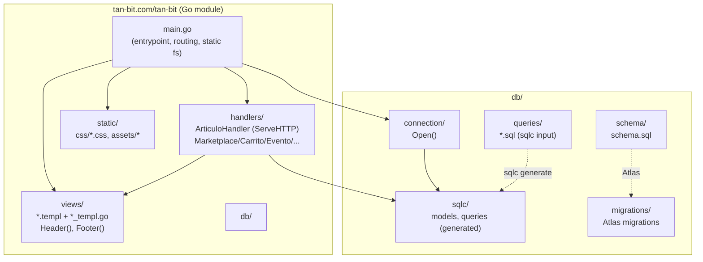
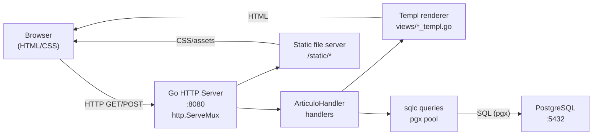
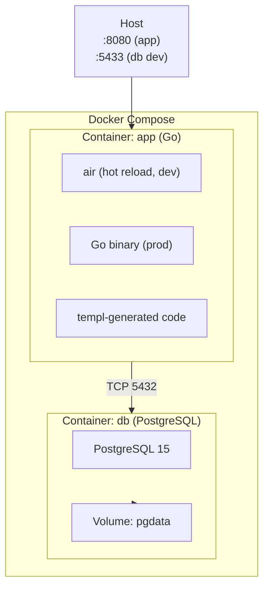
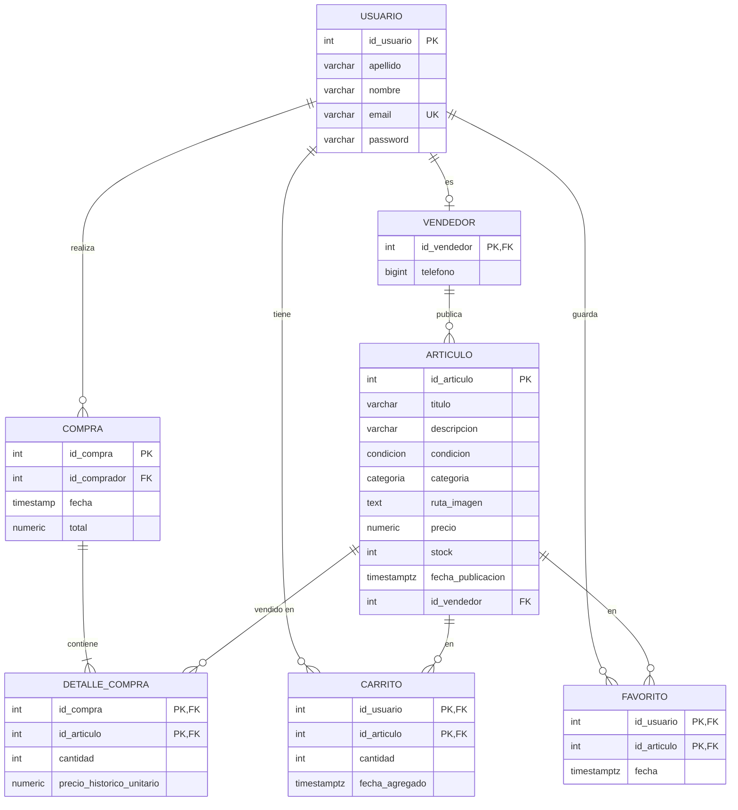

# Diagramas de arquitectura — TAN-BIT

## 1. Estructura de módulos (module view)

## 2. Componentes y conectores (C&C view, runtime)

## 3. Despliegue (allocation view)

## 4. Modelo de datos (ERD)

