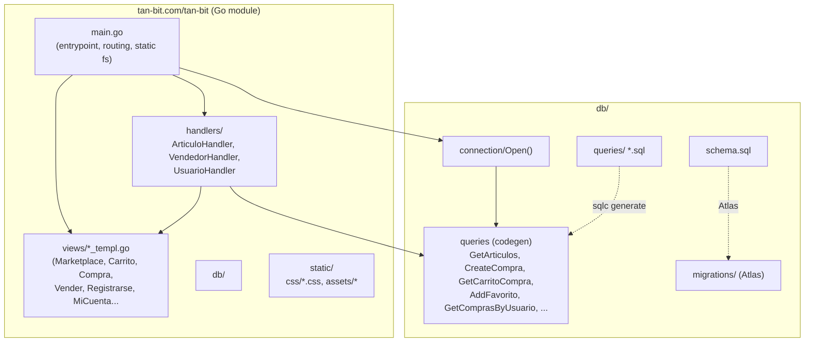
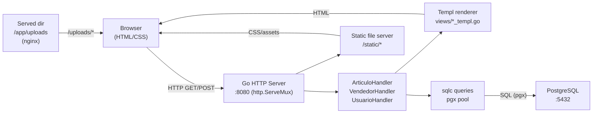
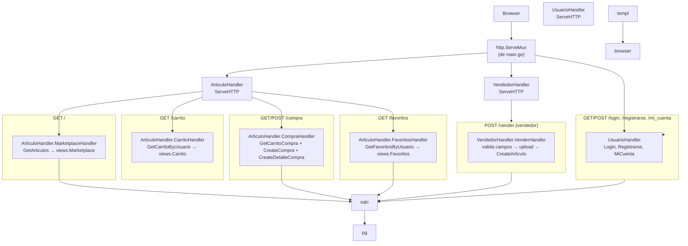
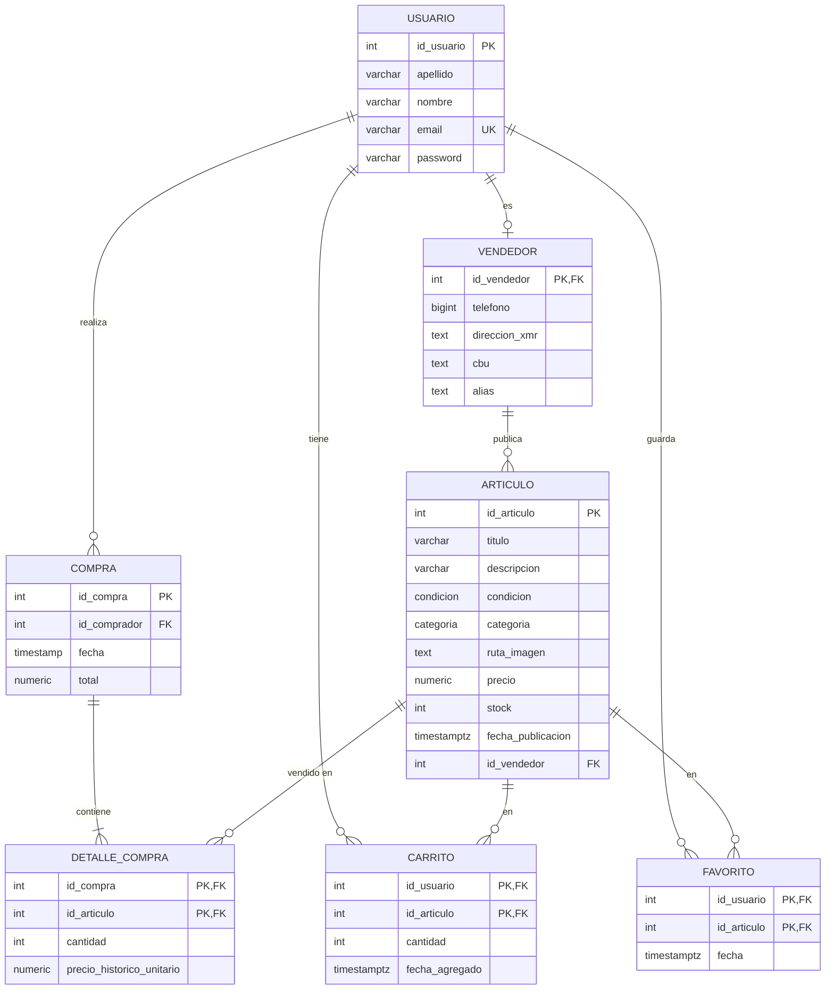

# Diagramas de arquitectura — TAN-BIT

## Componentes y conectores (C&C view, runtime)

## Diagrama de flujo de los handlers (flujo de petición)

## Modelo de datos (ERD)

---

## Notas de implementación

- **No hay JSON**. La capa de presentación es HTML generado con templ.
- **Autenticación**: cookie `user_id` (valor entero = `id_usuario`). El handler determina si el usuario es vendedor si el registro de `vendedor` existe.
- **Validación de formularios**: en `VenderHandler` y `RegistrarseHandler`; los errores se muestran como `errMsg` en la vista.
- **Subida de imágenes**: `sanitize()` + `os.MkdirAll("uploads", 0755)` + `io.Copy`. La ruta guardada es `/uploads/<nombre>`.
- **Migrations**: Atlas (`db/migrations/*.sql`). También los ficheros `.sql` en `db/schema/schema.sql` y `db/queries/*.sql` se usan para codegen de sqlc.
- **Docker**: `Dockerfile.prod` (builder + final alpine), `compose.prod.yaml` (api/db/nginx), `run-app.sh` (dev). Persistencia XMR: `db/uploads`, PG: `pgdata`.
